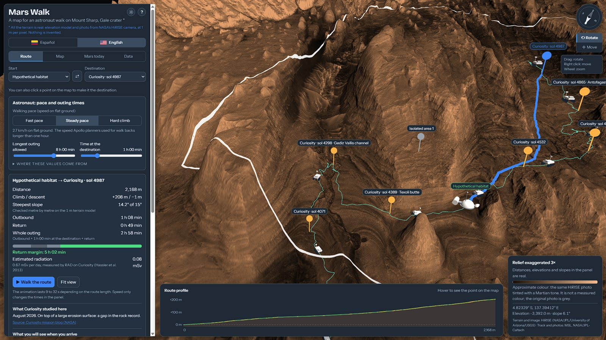
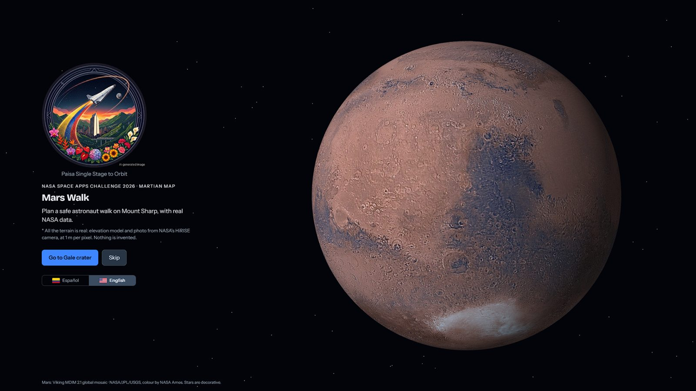
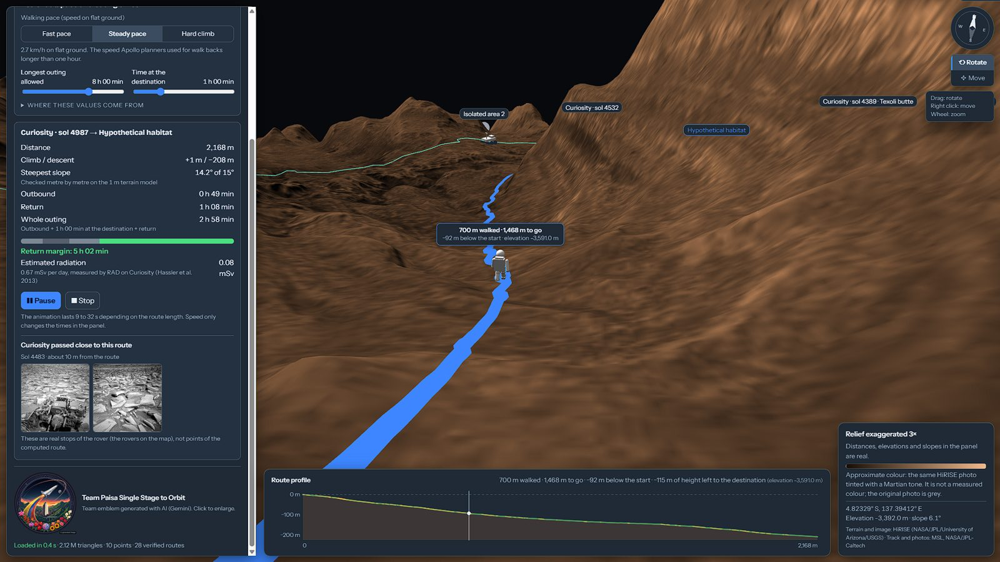

# Mars Walk Planner — Safe Astronaut Walks on Mount Sharp


A 3D map that plans safe walking routes for an astronaut on **Mount Sharp, Gale crater, Mars**, built on real NASA terrain at 1 m per pixel. Built for the **NASA Space Apps Challenge 2026** · challenge **Interplanetary Survival Guide: Martian Map** · Local Event **Medellín, Colombia** · team **Paisa Single Stage to Orbit**.

🔗 **Live app:** [mars-walk-planner.vercel.app](https://mars-walk-planner.vercel.app)
📑 **Demo (7 slides):** [Google Drive](https://drive.google.com/file/d/1YgNMzr2DwC8nlxjeb7uFC5ZFiWkJiQVE/view?usp=sharing)

> All the terrain is real: HiRISE elevation model and orthophoto from NASA, at 1 m per pixel. Nothing is invented.

---



---

## Overview

Before any science walk on Mars, a crew has to answer three questions: *Can we get there? How long will it take? Will we make it back?* Mars Walk Planner answers them on real terrain.

The user picks a start (a hypothetical habitat) and one of 7 science sites that NASA's Curiosity rover studied, including the **boxwork** formations of 2025. The app shows a route that never goes over **15° of slope**, the elevation profile, the time out and back with paces taken from Apollo planning, the return margin and an estimated radiation dose. An astronaut can then walk the route in 3D, and the panel shows what Curiosity studied at the site and the real photos it took there.

Where no safe route exists, the map says so.

---

## Key Features

- **Real 3D terrain** — HiRISE digital terrain model and orthophoto at 1 m per pixel; relief is exaggerated 3× on screen only, every number uses real heights
- **28 precomputed safe routes** between a hypothetical habitat and 7 Curiosity science sites, each checked metre by metre against a **15° slope limit**; pairs with no safe route are reported as such
- **Outing plan** — distance, climb and descent, steepest slope, time out, time at the destination, time back, whole outing, **return margin** and **estimated radiation**
- **Three walking paces** (fast, steady, hard climb) with their Apollo sources shown in the app
- **Elevation profile** linked to the map: hover the profile to see the point on the terrain
- **Animated walk** — an astronaut walks the route with live distance walked, distance left and height above the start
- **Science at every stop** — what Curiosity studied at each site, with a link to the NASA mission blog
- **Real rover photos** — Curiosity Navcam and Mastcam images taken near the route and at the destination
- **Mars today** — latest REMS weather from Gale crater and DONKI space-weather events, with saved fallbacks if a feed fails
- **Curiosity's real track** drawn on the terrain, aligned to the HiRISE model
- **Entrance globe** (Viking mosaic) with a zoom to Gale crater, and a **30-step guided tour**
- **English and Spanish**, light and dark mode
- **One static page** — no backend, no keys to configure, opens in any modern browser

---

## Screenshots

### Entrance



### Walk the route and see what Curiosity saw



---

## Challenge Objectives — How We Meet Them

| What the challenge asks | How Mars Walk Planner does it |
|---|---|
| A map or tool a Mars astronaut could use during a surface mission, with NASA data | Interactive 3D route planner on NASA HiRISE terrain |
| Start from scientific goals and a location | 7 sites Curiosity studied on Mount Sharp, including the boxwork area named in the challenge |
| Use at least three kinds of data | Five: topographic, optical, atmospheric, radiation and space weather (see below) |
| Astronaut safety first: radiation, space weather, mobility in a spacesuit | 15° slope limit, return margin, RAD dose estimate, DONKI space weather |
| A route map to the scientific objectives | Safe routes from the habitat to each science site, with time and profile |
| *Optional:* point-of-view images of what to expect on arrival | Real Curiosity photos at the destination |

---

## NASA Data

| Kind | Data | Source |
|---|---|---|
| Topographic | HiRISE DTM `DTEEC_009149_1750_009294_1750_U01`, 1 m | [USGS Astrogeology (STAC)](https://stac.astrogeology.usgs.gov/api/collections/mro_hirise_socet_dtms/items/DTEEC_009149_1750_009294_1750_U01) |
| Optical | HiRISE orthophoto `PSP_009149_1750_RED_C_01_ORTHO`, same 1 m grid | [USGS Astrogeology (STAC)](https://stac.astrogeology.usgs.gov/api/collections/mro_hirise_socet_dtms/items/DTEEC_009149_1750_009294_1750_U01) |
| Optical | Curiosity Navcam and Mastcam raw images | [Mars Raw Images API](https://mars.nasa.gov/api/v1/raw_image_items/) |
| Optical | Viking MDIM 2.1 global colour mosaic (entrance globe) | [USGS Astrogeology](https://astrogeology.usgs.gov/search/map/mars_viking_colorized_global_mosaic_232m) |
| Atmospheric | REMS weather feed, Curiosity | [mars.nasa.gov weather feed](https://mars.nasa.gov/rss/api/?feed=weather&category=msl&feedtype=json) |
| Radiation | RAD surface dose, 0.67 mSv per day (Hassler et al., *Science*, 2013) | [doi:10.1126/science.1244797](https://doi.org/10.1126/science.1244797) |
| Space weather | DONKI WSA-ENLIL simulations | [api.nasa.gov](https://api.nasa.gov/) |
| Rover track | Curiosity waypoints (`MSL_waypoints.json`) | [NASA MMGIS](https://mars.nasa.gov/mmgis-maps/MSL/Layers/json/MSL_waypoints.json) |
| Science context | Curiosity mission blog | [science.nasa.gov](https://science.nasa.gov/blog/sols-4532-4533-polygon-heaven/) |
| Walking paces | Apollo Lunar Surface Journal | [ALSJ](https://www.nasa.gov/wp-content/uploads/static/history/alsj/a11/a11.gaits.html) |

The slope limit of 15° follows MoonPath (Peña-Asensio et al., *Acta Astronautica* 214, 2024, [doi:10.1016/j.actaastro.2023.10.010](https://doi.org/10.1016/j.actaastro.2023.10.010)). Details of every file, its retrieval date and selection rule are in [`data/README.md`](data/README.md).

---

## How We Checked It

- **Rover vs terrain.** Curiosity's published positions were offset 55–97 m from the HiRISE model, inside the model's stated accuracy of ±100 m. We measured the shift and corrected it: at **467 control stops** not used for the fit, the terrain height under the rover matches the height the rover reports, with a spread of **1.66 m**.
- **Every route.** All **28 routes** were verified metre by metre on the 1 m terrain model against the 15° slope limit.
- **Independent check.** Routes and profiles were also checked by hand in Global Mapper (CSV files in `exports/` and `inputs/`); the test outputs are in `results/`.

### Limits

- **No rock map:** no ready-made boulder map was found for this area, so small obstacles below the 1 m terrain resolution are not modelled.
- The habitat is **hypothetical**.
- REMS data is the **latest published sol**, not live weather on the day.
- Relief is exaggerated 3× on screen only.

---

## Tech Stack

| Layer | Technology |
|---|---|
| 3D rendering | Three.js 0.147.0 |
| Front end | Vanilla JavaScript (one module per feature), HTML, CSS |
| Data pipeline | Python with NumPy, pandas and Pillow |
| Route search | Least-cost path over the 1 m terrain grid with a slope limit |
| Fonts | Bricolage Grotesque, Instrument Sans |
| Hosting | Vercel (static page from `public/`) |
| Manual validation | Global Mapper |

---

## Project Structure

```
├── data/                    # NASA source data and saved feeds (large files: see data/README.md)
├── docs/images/             # README screenshots
├── exports/                 # CSV files for manual checks in Global Mapper
├── inputs/                  # Lines brought back from Global Mapper for comparison
├── pipeline/
│   ├── dtm_reader.py        # Reads the HiRISE DTM
│   ├── pathfinding.py       # Least-cost route search
│   ├── slope.py             # Slope from the terrain grid
│   ├── validate_*.py        # Validation scripts (track alignment, slope vs tilt, routes)
│   └── app/
│       ├── config.py        # Paths and parameters
│       ├── site_selection.py
│       ├── build_routes.py  # Precomputes and verifies the 28 routes
│       ├── smooth_track.py  # Curiosity track on the terrain
│       ├── ortho_layer.py   # Orthophoto layer
│       ├── globe_layer.py   # Entrance globe texture
│       ├── emblem_layer.py  # Team emblem with watermark
│       ├── fetch_rems.py    # Refreshes the saved REMS record
│       └── build_page.py    # Assembles the single static page
├── public/
│   └── index.html           # Built page served by Vercel
├── results/                 # Validation outputs and app data (routes.json, points.json)
├── web/
│   ├── template.html
│   ├── style.css
│   └── js/                  # Front-end modules (terrain, routes, walker, tour, i18n, ...)
├── LICENSE
└── requirements.txt
```

---

## Getting Started

### Just use it

Open [mars-walk-planner.vercel.app](https://mars-walk-planner.vercel.app), or open `public/index.html` in a browser.

### Rebuild from the source data

Prerequisites: Python 3.10+ and the three large files listed in [`data/README.md`](data/README.md).

```bash
git clone https://github.com/CauseofDeathLife/mars-walk-planner.git
cd mars-walk-planner
pip install -r requirements.txt
```

Run the pipeline in this order:

```bash
cd pipeline
python validate_track_alignment.py
cd app
python site_selection.py
python build_routes.py      # about 3 minutes
python smooth_track.py
python build_page.py        # writes public/index.html
```

---

## Deployment

Vercel serves `public/` as a static site (Application Preset: Other, Output Directory: `public`). Every push to `main` redeploys automatically.

---

## Design Decisions

- **Precomputed, verified routes instead of free routing** — every route shown has been checked metre by metre; nothing is promised that was not verified
- **One static page** — the terrain and routes are embedded at build time, so the app needs no server, no API keys and keeps working after the hackathon
- **Saved fallbacks for live feeds** — if REMS or DONKI fail, the app falls back to the last saved record in `data/`
- **Honest numbers** — exaggeration is visual only, paces and doses show their sources, and unsafe pairs are reported instead of hidden
- **Readable for anyone** — English and Spanish, a guided tour and plain-language labels

---

## Use of AI

The idea, the choice of challenge, the design of the tool and the validation plan are the author's, and the author ran the manual checks in Global Mapper. Claude (Anthropic) was used as a coding and research assistant: it wrote most of the code under the author's direction and helped check data and draft the texts, including this README and the demo slides. Claude Code was used during preparation. The team emblem was generated with Gemini (Google) and carries a visible "AI-generated image" watermark; Gemini was also used to summarize the official submission video. No NASA logos or mission identifiers were generated or modified with AI.

---

## Author

**Daniel Esteban Quintero Caro** — Team Paisa Single Stage to Orbit

- [GitHub: CauseofDeathLife](https://github.com/CauseofDeathLife)
- [Linktree](https://linktr.ee/DanielEstebanQuintero)
- [LinkedIn](https://www.linkedin.com/in/danielesban/)

---

## License

Original code and content released under the [Apache License 2.0](LICENSE). The NASA Space Apps Terms and Conditions require original content to be open source (OSI-approved) and apply Apache 2.0 when no licence is specified.

**Third-party materials and their licences**

| Material | Licence |
|---|---|
| Three.js 0.147.0 | MIT |
| Bricolage Grotesque, Instrument Sans (fonts) | SIL Open Font License 1.1 |
| NASA data and images (HiRISE, Curiosity, REMS, DONKI, RAD, Viking) | NASA open data, credited below |
| NumPy, pandas, Pillow (build pipeline only) | BSD-3-Clause, BSD-3-Clause, MIT-CMU |

Global Mapper was used only for manual checks and is not part of the solution.

NASA data and images are credited to their sources above (NASA/JPL-Caltech, University of Arizona, USGS). REMS data: Centro de Astrobiología (CAB, CSIC-INTA) and NASA/JPL-Caltech. The team emblem is an AI-generated image (Gemini) and is marked as such.
